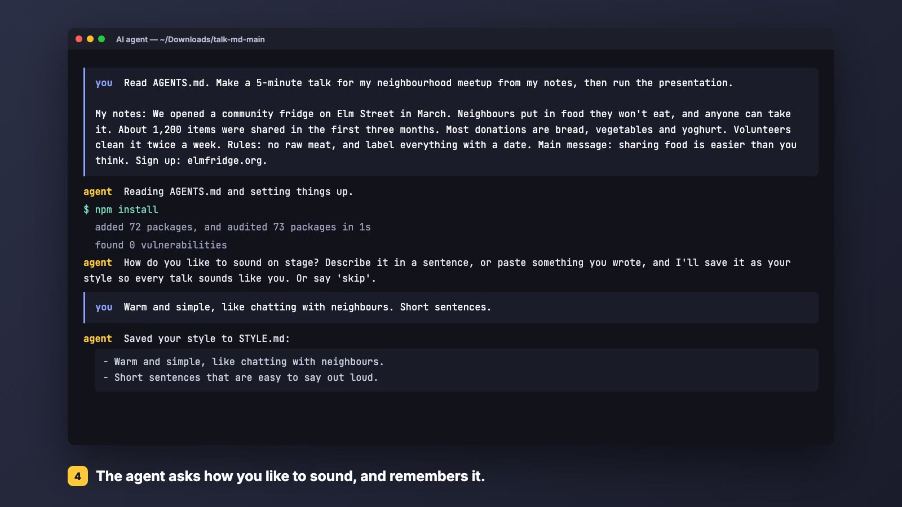
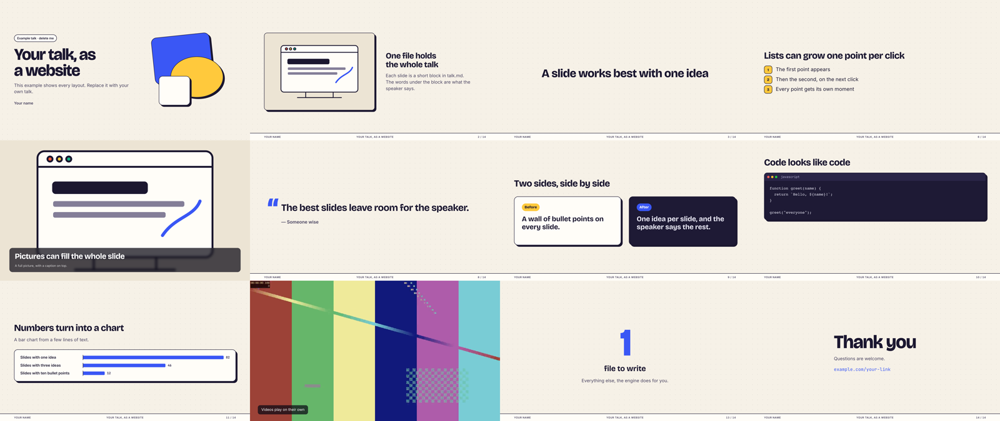

# talk-md

**Your notes in. A talk out.**

Tell your AI agent what your talk is about, in your own words. It writes the slides and your speaker notes, checks every slide, and opens the talk in your browser. Then you keep talking to it until the talk feels right.

No slide app. No code. One text file you own.

[](docs/getting-started.mp4)

▶ **[Watch: from one message to your first talk](docs/getting-started.mp4)** · 30 seconds: share the link, present, and fix a line in the notes

---

## Why talk-md

**Just say what you need.** "Make a 10-minute talk for product managers. Here are my notes." That's the whole instruction. The agent sets everything up, writes the talk, and keeps it open in your browser while it works, like a designer sitting next to you. "Make slide 4 shorter." "Use the dark theme." "The ending feels flat." You watch each change appear on screen.

**Slides people can follow.** One idea per slide, a short title, and the rest said out loud. That's how audiences take in a talk best, so the agent writes it that way by default. Lists can grow one point per click, and there are 13 layouts and 3 themes to choose from.

**Your clicker just works.** Bring the presentation clicker you already own. Its next and back buttons move the slides, and so do the arrow keys, the space bar and a click.

**Notes that work on stage.** Press N and your speaker notes open in a small window that floats above everything else, even your video call. Park it under your camera, share only the slides, and read your next line while you look people in the eye. The notes follow every click and show what comes next.

**Fix your notes while you rehearse.** A sentence sounds off out loud? Click into the notes, retype it, and click away. It saves straight into your talk, so the next rehearsal starts from the better version. The video above shows it at the end.

**It sounds like you.** The first time, the agent asks how you like to sound: describe it, or paste something you wrote. Every time you correct its wording later, it remembers. Your style lives in `STYLE.md` and carries over to your next talk.

**Checked before you present.** One check opens every slide and catches text that overflows, pictures that are missing, and two slides in a row that look the same.

**A PDF when you need one.** The organisers want your slides? Ask your agent: "Can I get a PDF of my talk?" It makes one, one page per slide, and tells you where it saved it. No command to learn.

**Yours, in one file.** The whole talk is `talk.md`: easy to keep, copy, share and track in git. Ask your agent to put the talk online, and it becomes a website with one link.

---

## Get started (no coding needed)

You need an AI coding agent, such as Claude Code, Codex, Cursor or Copilot. Open it, share this link, and say what you need, in your own words:

> Set up github.com/KateAstrid/talk-md and make me a 10-minute talk for product managers. The one thing they should remember is that small releases are safer. Here are my notes: …

That's it. The agent gets talk-md, sets it up, writes your talk and opens it in your browser, so you never download anything or type a command. Later, just ask for what you need: "make slide 3 shorter", "switch to the dark theme", "give me a PDF for the organisers". Put any pictures you'd like to use in the `media/` folder.

## For AI agents

If someone shared this link with you, clone the repository into a new folder (`git clone https://github.com/KateAstrid/talk-md`), work inside that folder, and follow [`AGENTS.md`](AGENTS.md) from the start. Do every step yourself, and keep the person's request as the talk to make.

## Works with your agent

talk-md ships the instruction file each agent looks for, so it knows what to do the moment you open the folder. Each one is set up the way that agent's own documentation describes.

| Agent | Reads |
| --- | --- |
| Claude Code | `CLAUDE.md`, which imports `AGENTS.md` |
| OpenAI Codex | `AGENTS.md` |
| Cursor | `.cursor/rules/talk-md.mdc` and `AGENTS.md` |
| GitHub Copilot | `.github/copilot-instructions.md` and `AGENTS.md` |
| Gemini CLI | `GEMINI.md`, which imports `AGENTS.md` |
| Windsurf | `AGENTS.md` |

All the real instructions live in one place, `AGENTS.md`: the workflow, the rules for good slides, and the `talk.md` format.

## See how it works

[](docs/demo.mp4)

▶ **[Watch the tour](docs/demo.mp4)** · 45 seconds: click through a talk, change `talk.md` and watch the slide update, fix a line in the notes, run the check.

## Presenting

| Do this | Press |
| --- | --- |
| Next slide | → , space, a click, or your clicker's next button |
| Previous slide | ← or your clicker's back button |
| Speaker notes | N |
| Full screen | F |
| First or last slide | Home or End |

On a video call, drag the notes window right under your camera and share only the tab with the slides. Every slide has its own address: `…/#7` opens slide 7, which is handy for questions afterwards.

## Every layout

Cover, statement, text, list, split, full picture, quote, compare, code, video, chart, big number and closing:



## Start by hand

You never need these commands: your agent runs them for you. They're here if you'd rather write `talk.md` yourself.

```bash
git clone https://github.com/KateAstrid/talk-md
cd talk-md
npm start
```

That opens the example talk, installing anything it needs the first time. Edit `talk.md`, save, and the browser shows the change. `AGENTS.md` explains the format and every layout.

| Command | What it does |
| --- | --- |
| `npm start` | Opens the talk in your browser |
| `npm run check` | Checks every slide: text that overflows, missing pictures, repeated layouts |
| `npm run pdf` | Saves `export/talk.pdf`, one page per slide |
| `npm run build` | Builds a website in `dist/` that you can put online (Netlify, Vercel, GitHub Pages) |
| `npm test` | Tests the engine itself |

`npm run check` and `npm run pdf` use Google Chrome. Without Chrome, run `npx playwright install chromium` once.

## What's inside

```
talk.md       the whole talk: slides and speaker notes
media/        your pictures and videos
STYLE.md      your tone and words, made with you on first use
AGENTS.md     instructions for AI agents
engine/       the code that turns talk.md into slides
```

## Where it comes from

talk-md is the engine behind [Kate Astrid](https://kate-astrid.com)'s conference talks, cleaned up so anyone can use it. It keeps the ideas that worked on stage: one idea per slide, short words on the slide and the rest spoken, lists that grow one point per click, notes that float above the call, and a check that looks at every slide before the talk.

## License

MIT. Use it, change it, and share it; keep the copyright notice in your copy.
