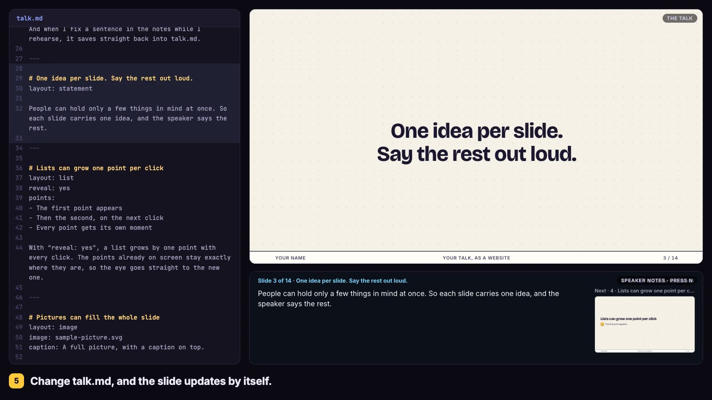

# talk-md

Write your talk in one text file. Present it in the browser.

You give your AI agent your notes, your outline or your rough ideas. The agent writes the slides and the speaker notes into one file, `talk.md`, and opens the talk in your browser. You present it with a clicker, read your notes in a small window that floats above your video call, and fix a sentence in your notes while you rehearse. The fix saves straight into the file.

No slide app, and no code to write.

[](docs/demo.mp4)

▶ **[Watch the 45-second demo](docs/demo.mp4)**: click through a talk, change `talk.md` and see the slide update, fix a line in the notes and see it saved.

## Start with an AI agent (no coding needed)

You need [Node.js](https://nodejs.org) (the LTS version) and an AI coding agent, such as Claude Code, Cursor, GitHub Copilot or Codex.

1. Download this folder: click **Code → Download ZIP** on GitHub and unzip it, or clone it.
2. Open the folder in your agent.
3. Tell the agent what the talk is about. For example:

   > Read AGENTS.md. Then make a 10-minute talk for product managers from my notes below. The one thing they should remember is that small releases are safer. Then run the presentation.
   >
   > (paste your notes here)

The agent installs everything, writes `talk.md`, checks every slide, and opens the talk in your browser.

Want changes? Ask for them in plain words: "make slide 4 shorter", "use the dark theme", "add this photo to the team slide". Put any pictures you want to use in the `media/` folder first.

**The talk will sound like you.** The first time, the agent asks how you like to sound: describe it, or paste something you wrote. It saves your answer in `STYLE.md`. Every time you correct its wording later ("too formal", "I'd never say that"), it adds that to `STYLE.md` too, so each talk sounds more like you. You can also edit `STYLE.md` yourself, starting from `STYLE.example.md`.

## Start by hand

```bash
npm install
npm start
```

`npm start` opens the example talk. Edit `talk.md`, save, and the browser shows the change. `AGENTS.md` explains the format and every layout.

## Presenting

| Do this | Press |
| --- | --- |
| Next slide | → , space, a click, or your clicker |
| Previous slide | ← |
| Speaker notes | N |
| Full screen | F |
| First or last slide | Home or End |

The **speaker notes** open in a small window that stays on top of every other window (in Chrome). On a video call, drag it right under your camera and share only the tab with the slides. The notes show what to say on this slide and a preview of the next one. Click into the text to fix a sentence; it saves into `talk.md` when you click away.

Every slide has its own address. The number after `#` is the slide number, so `…/#7` opens slide 7.

## Commands

| Command | What it does |
| --- | --- |
| `npm start` | Opens the talk in your browser |
| `npm run check` | Checks every slide: text that overflows, missing pictures, repeated layouts |
| `npm run pdf` | Saves `export/talk.pdf`, one page per slide |
| `npm run build` | Builds a website in `dist/` that you can put online (Netlify, Vercel, GitHub Pages) |
| `npm test` | Tests the engine itself |

`npm run check` and `npm run pdf` use Google Chrome. Without Chrome, run `npx playwright install chromium` once.

## Every layout


## What's inside

```
talk.md       the whole talk: slides and speaker notes
media/        your pictures and videos
AGENTS.md     instructions for AI agents
STYLE.md      optional: your own tone and words (start from STYLE.example.md)
engine/       the code that turns talk.md into slides
```

The engine comes from the decks Kate Astrid builds for her own conference talks. It keeps the ideas that worked on stage: one idea per slide, short words on the slide and the rest spoken, lists that grow one point per click, notes that float above the call, and a check that looks at every slide before you present.

## License

MIT. Use it, change it, and share it; keep the copyright notice in your copy.
